# ha-network-panel

[](https://www.home-assistant.io/integrations/marketplace/)
[](https://github.com/juju35/ha-network-panel/actions/workflows/hacs.yml)
[](https://github.com/juju35/ha-network-panel/actions/workflows/validate.yml)
[](https://github.com/juju35/ha-network-panel/actions/workflows/lint.yml)
[](https://github.com/juju35/ha-network-panel/releases/latest)
[](https://github.com/juju35/ha-network-panel/blob/main/LICENSE)
[](https://buymeacoffee.com/julienstep9)

<p align="center"></p>

<p align="center">
  <a href="https://www.free.fr"></a>&nbsp;&nbsp;
  <a href="https://www.orange.fr"></a>&nbsp;&nbsp;
  <a href="https://www.sfr.fr"></a>&nbsp;&nbsp;
  <a href="https://www.bouyguestelecom.fr"></a>&nbsp;&nbsp;
  <a href="https://fritz.com"></a>&nbsp;&nbsp;
  <a href="https://www.vodafone.com"></a>&nbsp;&nbsp;
  <a href="https://www.starlink.com"></a>&nbsp;&nbsp;
  <a href="https://ui.com"></a>&nbsp;&nbsp;
  <a href="https://www.tp-link.com"></a>&nbsp;&nbsp;
  <a href="https://opnsense.org"></a>&nbsp;&nbsp;
  <a href="https://www.pfsense.org"></a>&nbsp;&nbsp;
  <a href="https://www.asus.com"></a>&nbsp;&nbsp;
  <a href="https://www.netgear.com"></a>&nbsp;&nbsp;
  <a href="https://mikrotik.com"></a>&nbsp;&nbsp;
  <a href="https://openwrt.org"></a>&nbsp;&nbsp;
  <a href="https://adguard.com/adguard-home/overview.html"></a>&nbsp;&nbsp;
  <a href="https://pi-hole.net"></a>&nbsp;&nbsp;
  <a href="https://www.speedtest.net"></a>&nbsp;&nbsp;
  <a href="https://fast.com"></a>&nbsp;&nbsp;
</p>

Home Assistant integration that adds a **Network** panel to the sidebar, on top of the integrations of your network gear: the internet box, the routers, firewalls and mesh access points, **as many switches as you have**, the Wi-Fi networks, the connected devices, the DNS filter (AdGuard Home or Pi-hole), the speed tests and the reverse proxy — on one page, with the box, router and switches drawn as in the ha-* cards.

<p align="center">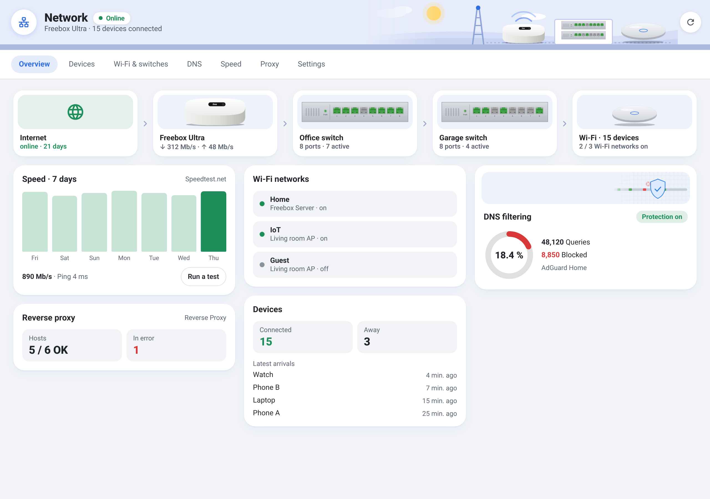</p>

[](https://my.home-assistant.io/redirect/marketplace_repository/?owner=juju35&repository=ha-network-panel&category=integration)

## Features

- **Illustrated top bar**: the internet box, the switches in their rack and the router under a day sky with a light theme, a night sky with a dark one; the box's Wi-Fi waves while a Wi-Fi network is on; a status pill (Online, Internet down, No internet box), the box model and how many devices are connected, and a round **Refresh** button
- **Overview**: the topology (internet → box → router → switches and access points), download / upload right now and the last 7 days of speed tests, the reverse proxy hosts, the Wi-Fi networks with their switches, the latest devices and the DNS filter at a glance
- **Devices**: every device tracked by a router, connected or away, with its IP, MAC, Wi-Fi network or cable and when it was last seen; filter and search by name, IP, MAC or host name
- **Wi-Fi & switches**: the Wi-Fi networks (turn them on or off), the routers and access points with their client count and temperature, and **each switch's front panel** with its ports lit by their link state
- **DNS**: queries, blocked queries, block ratio and average time of AdGuard Home or Pi-hole, and its protections (on / off)
- **Speed**: download, upload and ping of the last test, a **Run a test** button and the daily peaks of the last 30 days
- **Proxy**: the hosts of the reverse proxy and whether they answer
- **Settings**: the integrations read and their state, away devices shown or not, and the confirmation before turning a Wi-Fi network or a protection off
- Tabs without a source are hidden; **administrators only**: the panel and its commands are kept for administrators
- Light and dark themes, phones and desktops, 22 languages
- No connection of its own: the panel reads the entities of your network integrations and uses their switches and buttons

## Supported integrations

| Kind | Integrations |
|---|---|
| Internet box | [Freebox](https://www.home-assistant.io/integrations/freebox/), [Livebox](https://github.com/cyr-ius/hass-livebox-component), [SFR Box](https://www.home-assistant.io/integrations/sfr_box/), [Bbox](https://github.com/cyr-ius/hass-bbox2), [FRITZ!Box Tools](https://www.home-assistant.io/integrations/fritz/), [Vodafone Station](https://www.home-assistant.io/integrations/vodafone_station/), [Huawei LTE](https://www.home-assistant.io/integrations/huawei_lte/), [Starlink](https://www.home-assistant.io/integrations/starlink/), [Swisscom Internet-Box](https://www.home-assistant.io/integrations/swisscom/), [Sagemcom F@st](https://www.home-assistant.io/integrations/sagemcom_fast/), ZTE Hyperbox |
| Routers, firewalls, mesh, switches | [UniFi Network](https://www.home-assistant.io/integrations/unifi/), [TP-Link Omada](https://www.home-assistant.io/integrations/tplink_omada/), [TP-Link Deco](https://github.com/amosyuen/ha-tplink-deco), [OPNsense](https://github.com/travisghansen/hass-opnsense), [pfSense](https://github.com/travisghansen/hass-pfsense), [ASUSWRT](https://www.home-assistant.io/integrations/asuswrt/), [NETGEAR](https://www.home-assistant.io/integrations/netgear/), [MikroTik](https://www.home-assistant.io/integrations/mikrotik/), [Keenetic NDMS2](https://www.home-assistant.io/integrations/keenetic_ndms2/), [Firewalla](https://github.com/firewalla/home-assistant), [OpenWrt (ubus / luci)](https://www.home-assistant.io/integrations/ubus/), [eero](https://github.com/schmittx/home-assistant-eero), GL.iNet |
| DNS filter | [AdGuard Home](https://www.home-assistant.io/integrations/adguard/), [Pi-hole](https://www.home-assistant.io/integrations/pi_hole/) |
| Speed test | [Speedtest.net](https://www.home-assistant.io/integrations/speedtestdotcom/), [Fast.com](https://www.home-assistant.io/integrations/fastdotcom/) |
| Reverse proxy | [Nginx Proxy Manager](https://github.com/Teagan42/HomeAssistantNginxProxyManager) and other reverse proxy integrations whose hosts are binary sensors or sensors |
| Connected devices | The `device_tracker` entities of any router integration (`source_type: router`) |

Any other switch (SNMP, a generic integration…) can be added in the integration's options: its port entities (`port 1`, `port_2`…) light its front panel.

## Prerequisites

Home Assistant 2026.11 or later, and at least one of the integrations above.

## Installation

### Via the Marketplace (recommended)

Click the button below to add the repository directly:

[](https://my.home-assistant.io/redirect/marketplace_repository/?owner=juju35&repository=ha-network-panel&category=integration)

Then click **Install** and restart Home Assistant.

Or manually:

1. Open **Settings → Marketplace → Add from link** (top right; this needs a GitHub account connected)
2. Add `https://github.com/juju35/ha-network-panel` — Type: **Integration**
3. Open **Network Panel** and click **Install**, then restart Home Assistant

Then **Settings → Devices & services → Add integration → Network Panel**: pick the integrations to read (all of those found by default) and the devices to show as switches, and the **Network** entry appears in the sidebar. The panel is an integration: nothing to add to `/local/community/` or to the dashboard resources.

### Manual

1. Download `network_panel.zip` from the [latest release](https://github.com/juju35/ha-network-panel/releases/latest)
2. Extract it to `/config/custom_components/network_panel/`
3. Restart Home Assistant and add the **Network Panel** integration

## Panel

The **Network** entry of the sidebar, at `/network` (each tab has its own address: `/network/devices`, `/network/wifi`, `/network/dns`, `/network/speed`, `/network/proxy`, `/network/settings`). It is for administrators only: other users do not see it in the sidebar, and its commands refuse them.

| Light | Dark |
|---|---|
|  | 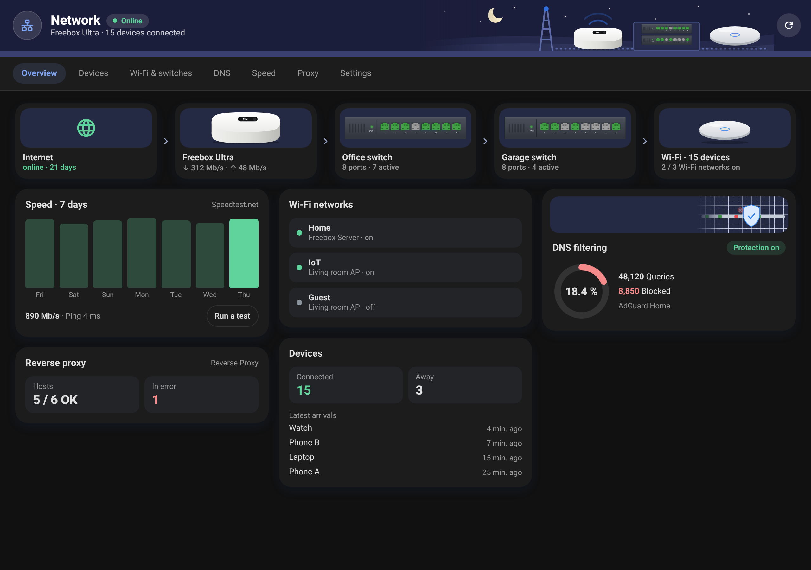 |
| 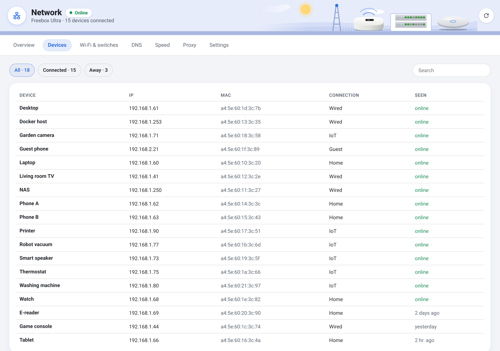 | 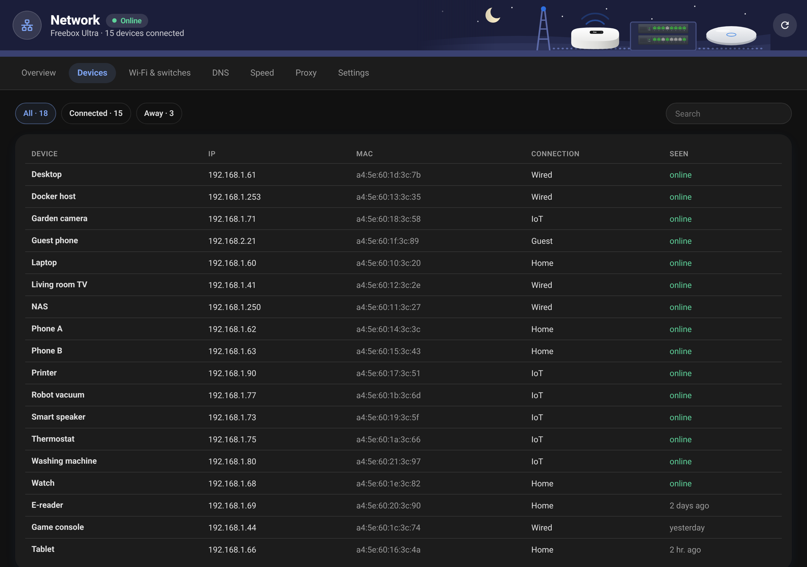 |
| 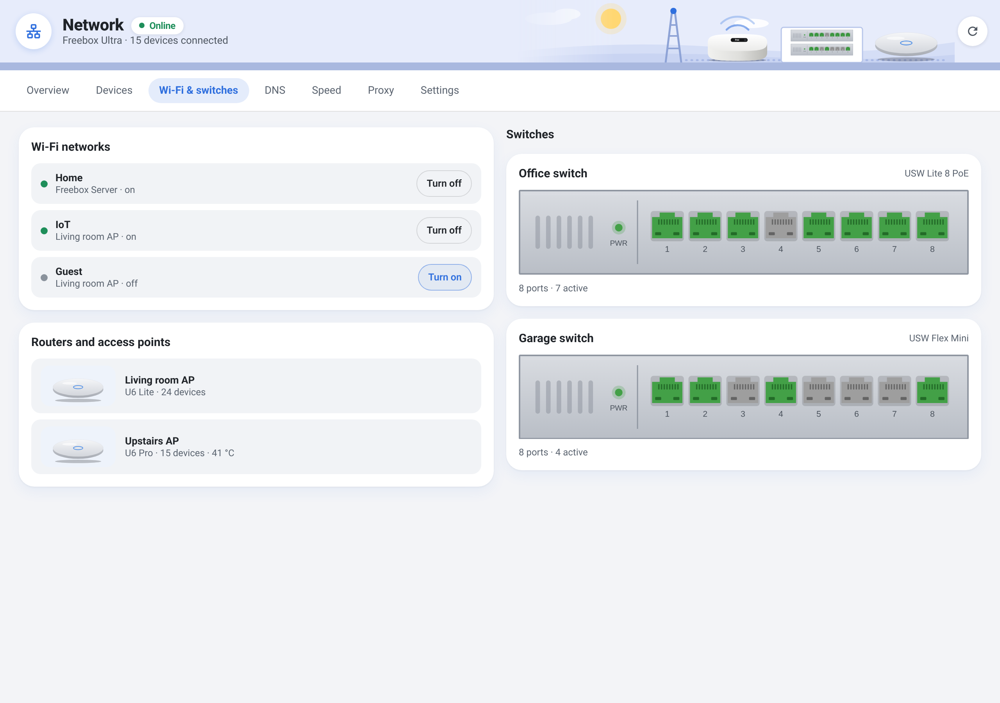 | 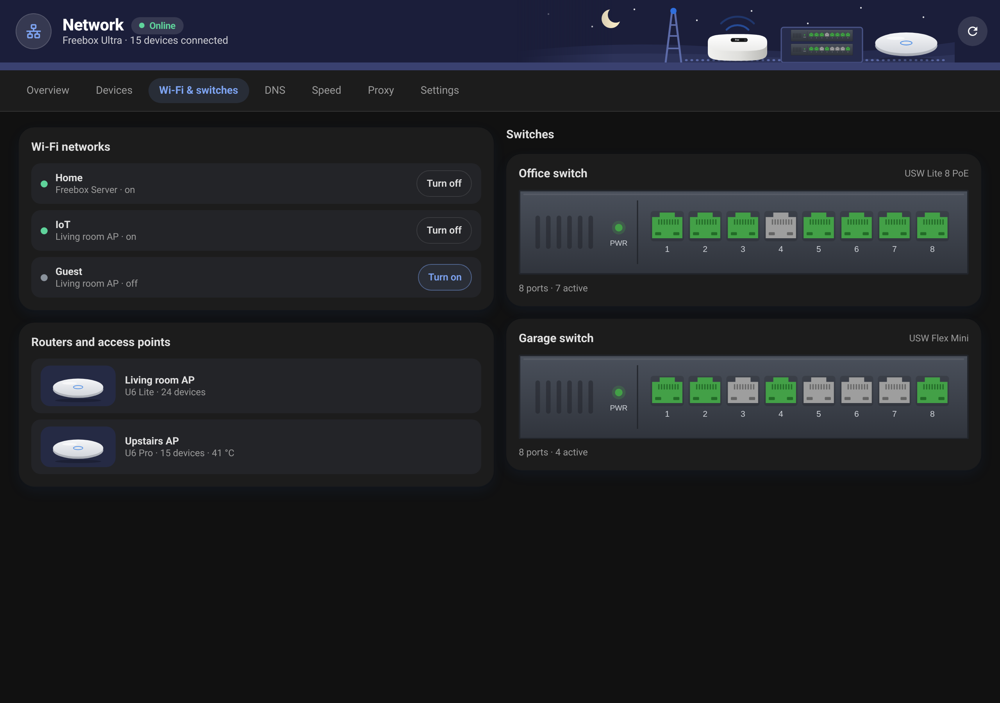 |
| 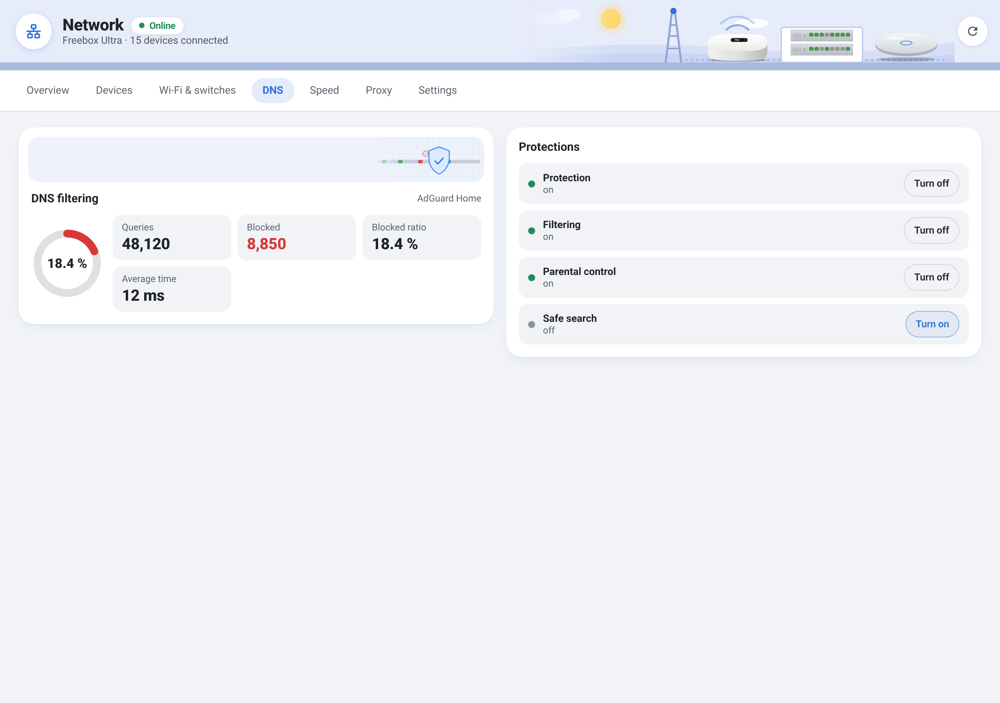 | 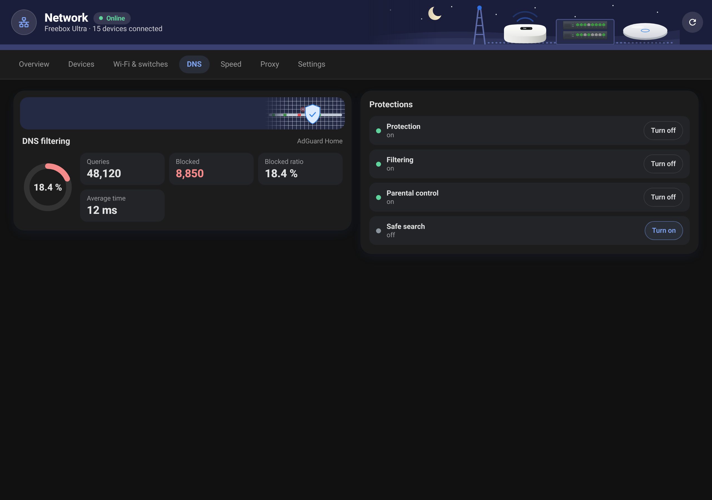 |
| 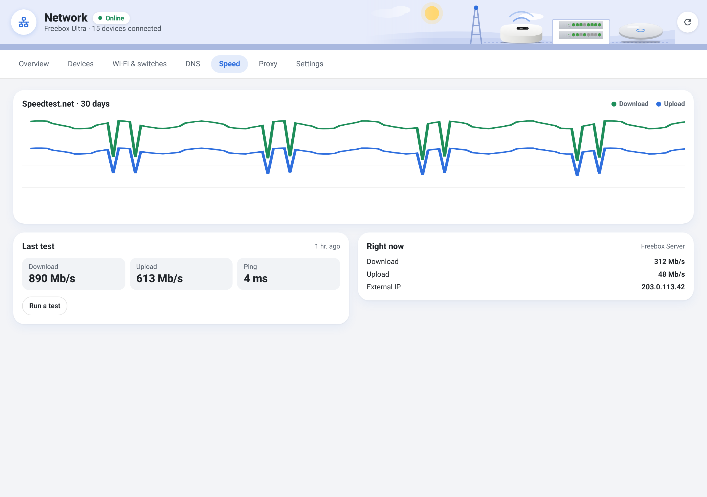 | 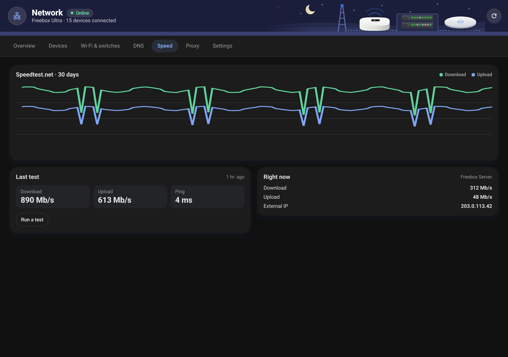 |
| 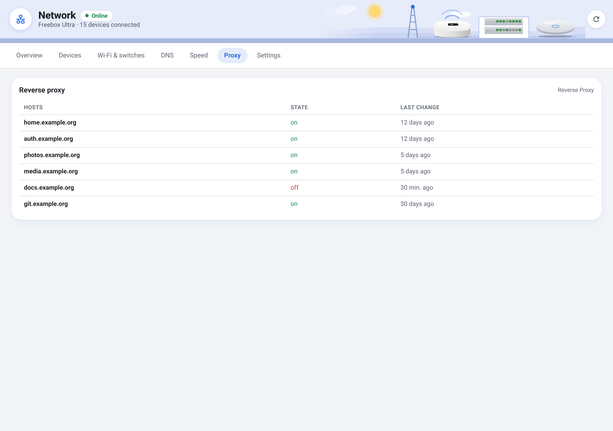 | 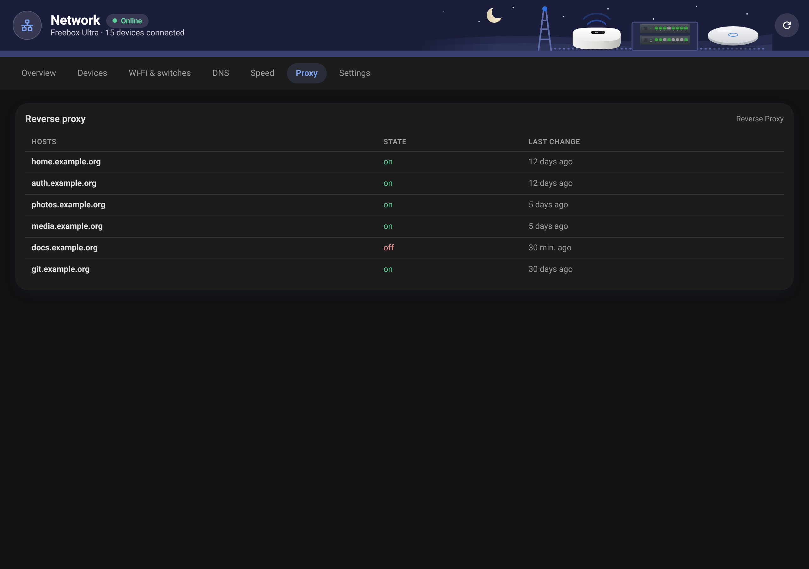 |
| 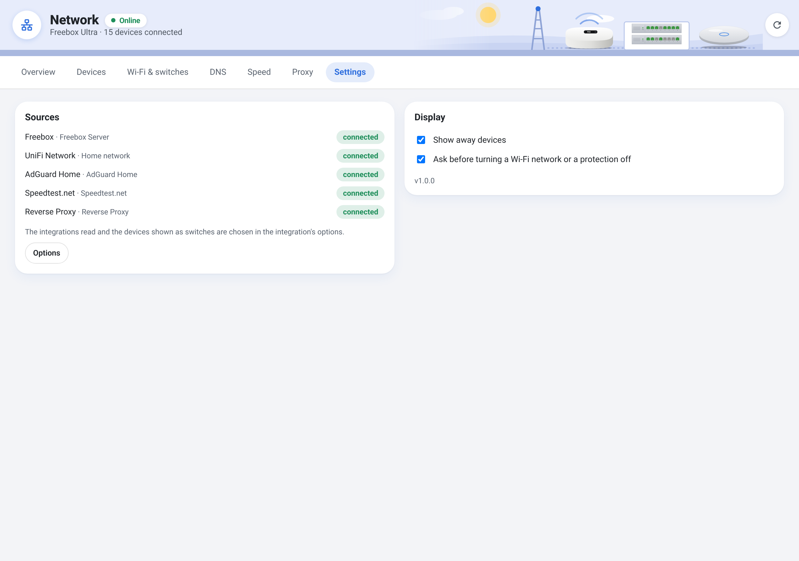 | 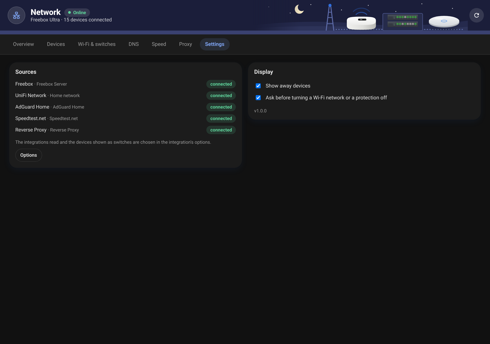 |

### Options

**Settings → Devices & services → Network Panel → Configure**:

| Option | What it does |
|---|---|
| Sources | The integrations the panel reads (all of the supported ones set up, when none is chosen) |
| Switches | Devices shown as switches whatever their model, including from integrations not listed above |

### Settings

| Setting | Default | What it does |
|---|---|---|
| Show away devices | on | Off: the Devices tab lists the connected devices only |
| Ask before turning off a Wi-Fi network or a protection | on | Turning a Wi-Fi network or a DNS protection off waits for a confirmation |

## How it works

The integration reads the device and entity registries of the chosen integrations and tells the panel which entity is which: a device is a switch when its model says so (UniFi USW, Omada TL-SG, NETGEAR GS / XS, MikroTik CRS / CSS…) or when you chose it, an access point when it is one (UniFi U6 / U7 / UAP, Omada EAP, mesh nodes), the first device of a box integration is the internet box; each entity is told by its translation key, its device class, then its entity ID, so renamed entities and other languages are supported. The connected devices are the router device trackers, read straight from the states.

The inventory is scanned again only when the device or entity registry changes, a source entry changes state or title, or the options change. The speed history comes from the recorder (30 days of the download and upload sensors); **Run a test** asks the speed test sensor for an update (`homeassistant.update_entity`), and the Wi-Fi and protection buttons turn their switch on or off.

Rates are shown in bit/s (kb/s, Mb/s, Gb/s), download in green, upload in blue, as in the other ha-* projects.

## Development

```bash
pip install -r requirements_test.txt && pytest   # integration tests (Home Assistant test harness)
npm ci && npm test                               # assembles the panel (npm run build), then its tests
npm run screenshots                              # renders the panel with mock data into screenshots/
```

The panel is a plain JavaScript module served by the integration from `custom_components/network_panel/frontend/network-panel.js`, with its language files (`frontend/i18n/`). Its source is split into ES modules under `src/network-panel/` (entry `index.js`); `npm run build` (`scripts/build-frontend.mjs`) assembles them into that file, which is not committed (the release builds it into the zip).

## Translations

The panel auto-detects the language from your Home Assistant settings. English is built in; the other languages are loaded on demand. Currently supported:

| Language | Code |
|---|---|
| English | `en` |
| Français | `fr` |
| Deutsch | `de` |
| Español | `es` |
| Српски | `sr` |
| Srpski (latinica) | `sr-Latn` |
| Italiano | `it` |
| Nederlands | `nl` |
| Português (Portugal) | `pt` |
| Polski | `pl` |
| Română | `ro` |
| Dansk | `da` |
| Svenska | `sv` |
| Български | `bg` |
| Русский | `ru` |
| Українська | `uk` |
| Magyar | `hu` |
| Slovenčina | `sk` |
| Čeština | `cs` |
| Slovenščina | `sl` |
| Latviešu | `lv` |
| Ελληνικά | `el` |

Regional variants fall back to the base language (`it-IT` → `it`, `nl-BE` → `nl`); Brazilian Portuguese (`pt-BR`) uses the European Portuguese translation. Counts read "label: {n}" in languages where plurals vary.

Contributions for additional languages are welcome!

## Trademark

The brand names and logos shown belong to their owners and are used only to identify the integrations and devices this panel works with. This project is not affiliated with or endorsed by any of them.

## Support

If this panel is useful to you, you can [buy me a coffee](https://buymeacoffee.com/julienstep9). Homepage: [juju35.github.io/homeassistant-projects](https://juju35.github.io/homeassistant-projects/).

## License

MIT — see [LICENSE](https://github.com/juju35/ha-network-panel/blob/main/LICENSE).
